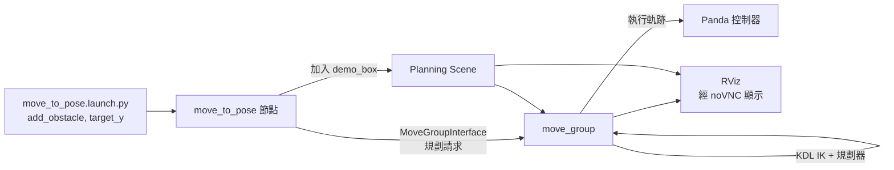

# moveit_demo：MoveIt 2 + Panda 避障動作規劃

使用 ROS 2 Jazzy 與 MoveIt 2，讓 Franka Panda 機械手臂在有障礙物的場景中規劃並執行移動到目標位姿的任務。整個環境跑在 Docker 容器內，並透過 noVNC 在瀏覽器顯示 RViz。

## 功能

- 以 `move_to_pose` 節點呼叫 `MoveGroupInterface`，規劃 `panda_arm` 到指定目標位置
- 可選擇在規劃場景中加入障礙物 `demo_box`，驗證避障規劃
- 目標位置的 XYZ 座標可由 launch 參數調整，方便比較不同路徑

## 環境

| 項目 | 內容 |
| --- | --- |
| ROS 2 | Jazzy |
| 動作規劃 | MoveIt 2（`moveit_ros_planning_interface`） |
| 機器人 | Franka Panda，規劃群組 `panda_arm` |
| 運動學 | KDL kinematics plugin |
| 容器 | Docker（image `ros2-jazzy-moveit`，容器 `ros2_moveit`） |
| 顯示 | noVNC 顯示 RViz |

## 專案結構

```
ros2_ws/
└── src/
    └── moveit_demo/            # ament_cmake 套件
        ├── src/move_to_pose.cpp 
        ├── launch/move_to_pose.launch.py
        ├── CMakeLists.txt
        └── package.xml
```

## 架構



流程說明：

1. launch 檔傳入 `add_obstacle` 與 `target_y` 並啟動 `move_to_pose`
2. 節點載入 Panda 模型，把 `demo_box` 加入規劃場景
3. 節點對 `panda_arm` 送出目標位姿的規劃請求，`move_group` 以 KDL 解算並規劃
4. 規劃成功後送出執行請求，手臂移動到目標，結果可在 RViz 觀察

## 建置與執行

```bash
# 進入容器後
cd /root/ros2_ws
colcon build --packages-select moveit_demo
source install/setup.bash

# 先啟動 Panda 的 move_group 與 RViz
ros2 launch moveit_resources_panda_moveit_config demo.launch.py

# 無障礙物
ros2 run moveit_demo move_to_pose --ros-args -p add_obstacle:=false -p target_y:=0.3 -p target_z:=0.4

# 加入障礙物並指定目標 Y
ros2 run moveit_demo move_to_pose --ros-args -p add_obstacle:=true -p target_y:=-0.3 -p target_z:=0.4
```

### launch 參數

| 參數 | 說明 | 範例 |
| --- | --- | --- |
| `add_obstacle` | 是否加入 `demo_box` 到規劃場景 | `true` |
| `target_y` | 目標位置的 Y 座標（公尺） | `0.3` |
| `target_z` | 目標位置的 Z 座標（公尺） | `0.4` |

目標位置固定為 X = 0.280、Z 由 `target_z` 決定，Y 由 `target_y` 決定。

## 測試紀錄

### 測試 1：有障礙物，目標 Y = 0.2

- 日期：2026-10-23
- 指令：`ros2 run moveit_demo move_to_pose --ros-args -p add_obstacle:=true -p target_y:=-0.3 -p target_z:=0.4`
- 目標：(0.280, -0.300, 0.400)

| 項目 | 結果 |
| --- | --- |
| 障礙物 `demo_box` | 成功加入 |
| 規劃 | 成功，耗時約 0.096 秒 |
| 執行 | `Execute request success!`，約 20 秒完成 |
| 程序結束 | 正常結束（`finished cleanly`） |

已知訊息：`kdl_parser` 警告 `panda_link0` 在 URDF 中有 inertia，KDL 不支援根連結的 inertia。這是 Panda URDF 的常見訊息，不影響規劃與執行。

避障確認：


### 待測項目

| 編號 | 情境 | 預期 | 結果 |
| --- | --- | --- | --- |
| 2 | 無障礙物，`target_y:=0.2` | 作為對照組，路徑較直接 | TODO |
| 3 | 有障礙物，`target_y:=-0.2` | 手臂需跨越 box 另一側，規劃時間可能增加 | TODO |
| 4 | 目標落在障礙物內 | 規劃失敗並回報 | TODO |

## 已知限制與後續

- 目前只有單一障礙物 `demo_box`
- 避障效果以目視 RViz 確認，尚未做自動化碰撞檢查
- 後續可加入多障礙物、不同規劃器比較（規劃時間與路徑長度）
