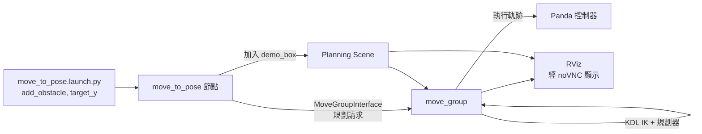

# MoveIt 2 + Panda：避障動作規劃與 MTC 多步驟 Pick and Place

使用 ROS 2 Jazzy 與 MoveIt 2，讓 Franka Panda 機械手臂完成兩類任務：

1. **單一動作加避障**（`moveit_demo` 套件）：用 `MoveGroupInterface` 在有障礙物的場景中規劃並移動到目標位姿
2. **多步驟任務編排**（`mtc_tutorial` 套件）：用 MoveIt Task Constructor（MTC）把撿取與放置拆成一連串 stage，整體規劃

整個環境跑在 Docker 容器內，並透過 noVNC 在瀏覽器顯示 RViz。

<!-- TODO: 放一張 RViz 手臂繞過 demo_box 的截圖或 GIF -->
<!--  -->

## 目錄

- [環境與專案結構](#環境與專案結構)
- [第一部分：單一動作加避障（moveit_demo）](#第一部分單一動作加避障moveit_demo)
- [第二部分：MTC 多步驟 Pick and Place（mtc_tutorial）](#第二部分mtc-多步驟-pick-and-placemtc_tutorial)
- [已知限制與後續](#已知限制與後續)
- [參考資料](#參考資料)

## 環境與專案結構

| 項目 | 內容 |
| --- | --- |
| ROS 2 | Jazzy |
| 動作規劃 | MoveIt 2（`moveit_ros_planning_interface`）、MoveIt Task Constructor |
| 機器人 | Franka Panda，規劃群組 `panda_arm`、夾爪群組 `hand` |
| 運動學 | KDL kinematics plugin |
| 容器 | Docker（image `ros2-jazzy-moveit`，容器 `ros2_moveit`） |
| 顯示 | noVNC 顯示 RViz |

```
ros2_ws/
├── run_tests.sh                   # moveit_demo 批次測試
├── run_mtc_tests.sh               # mtc_tutorial 批次測試
└── src/
    ├── moveit_demo/               # 單一動作加避障
    │   ├── src/move_to_pose.cpp   # TODO: 確認實際檔名
    │   ├── launch/move_to_pose.launch.py
    │   ├── CMakeLists.txt
    │   └── package.xml
    └── mtc_tutorial/              # MTC pick and place
        ├── src/mtc_node.cpp
        ├── launch/pick_place_demo.launch.py
        ├── CMakeLists.txt
        └── package.xml
```

---

## 第一部分：單一動作加避障（moveit_demo）

### 功能

- 以 `move_to_pose` 節點呼叫 `MoveGroupInterface`，規劃 `panda_arm` 到指定目標位置
- 可選擇在規劃場景中加入障礙物 `demo_box`，驗證避障規劃
- 目標位置的 Y 座標可由 launch 參數調整，方便比較不同路徑

### 架構



1. launch 檔傳入 `add_obstacle` 與 `target_y` 並啟動 `move_to_pose`
2. 節點載入 Panda 模型，把 `demo_box` 加入規劃場景
3. 節點對 `panda_arm` 送出目標位姿的規劃請求，`move_group` 以 KDL 解算並規劃
4. 規劃成功後送出執行請求，手臂移動到目標，結果可在 RViz 觀察

### 建置與執行

```bash
# 進入容器後
cd /root/ros2_ws
colcon build --packages-select moveit_demo
source install/setup.bash

# 先啟動 Panda 的 move_group 與 RViz
ros2 launch moveit_resources_panda_moveit_config demo.launch.py

# 無障礙物
ros2 launch moveit_demo move_to_pose.launch.py

# 加入障礙物並指定目標 Y
ros2 launch moveit_demo move_to_pose.launch.py add_obstacle:=true target_y:=0.2
```

| 參數 | 說明 | 範例 |
| --- | --- | --- |
| `add_obstacle` | 是否加入 `demo_box` 到規劃場景 | `true` |
| `target_y` | 目標位置的 Y 座標（公尺） | `0.2` |

目標位置固定為 X = 0.280、Z = 0.500，Y 由 `target_y` 決定。

### 測試紀錄

**測試 1：有障礙物，目標 Y = 0.2**（2026-10-23）

- 指令：`ros2 launch moveit_demo move_to_pose.launch.py add_obstacle:=true target_y:=0.2`
- 目標：(0.280, 0.200, 0.500)

| 項目 | 結果 |
| --- | --- |
| 障礙物 `demo_box` | 成功加入 |
| 規劃 | 成功，耗時約 0.096 秒 |
| 執行 | `Execute request success!`，約 20 秒完成 |
| 程序結束 | 正常結束（`finished cleanly`） |

已知訊息：`kdl_parser` 警告 `panda_link0` 在 URDF 中有 inertia，KDL 不支援根連結的 inertia。這是 Panda URDF 的常見訊息，不影響規劃與執行。

避障確認：<!-- TODO: 補上 RViz 截圖，說明手臂是否繞過 demo_box -->

**待測項目**

| 編號 | 情境 | 預期 | 結果 |
| --- | --- | --- | --- |
| 2 | 無障礙物，`target_y:=0.2` | 作為對照組，路徑較直接 | TODO |
| 3 | 有障礙物，`target_y:=-0.2` | 手臂需跨越 box 另一側，規劃時間可能增加 | TODO |
| 4 | 目標落在障礙物內 | 規劃失敗並回報 | TODO |

---

## 第二部分：MTC 多步驟 Pick and Place（mtc_tutorial）

### 為什麼用 MTC

單一動作的規劃只能處理「從 A 到 B」。撿東西這類任務的各步驟互相依賴（選哪個抓取姿態，決定接近與撤離能否成立），所以改用 MoveIt Task Constructor：把整個任務當成一個 **Task**，每個子問題是一個 **Stage**，由 MTC 找出端到端可行的解，並依成本排序。

MTC 不是新的路徑搜尋演算法，它負責的是任務編排；每一段動作底層仍然是 MoveIt 的規劃管線（預設 OMPL）、笛卡兒路徑或關節插值。官方教學也是這個定位：單一動作用 `MoveGroupInterface`，多步驟任務才用 MTC。

### 任務結構

```mermaid
flowchart LR
    A[current<br/>CurrentState] --> B[open hand<br/>MoveTo]
    B --> C[move to pick<br/>Connect]
    C --> P

    subgraph P[pick object：SerialContainer]
        direction LR
        P1[approach object<br/>MoveRelative] --> P2[generate grasp pose<br/>+ grasp pose IK]
        P2 --> P3[allow collision<br/>hand, object]
        P3 --> P4[close hand<br/>MoveTo]
        P4 --> P5[attach object]
        P5 --> P6[lift object<br/>MoveRelative]
    end

    P --> D[move to place<br/>Connect]
    D --> Q

    subgraph Q[place object：SerialContainer]
        direction LR
        Q1[generate place pose<br/>+ place pose IK] --> Q2[open hand<br/>MoveTo]
        Q2 --> Q3[forbid collision<br/>hand, object]
        Q3 --> Q4[detach object]
        Q4 --> Q5[retreat<br/>MoveRelative]
    end

    Q --> E[return home<br/>MoveTo ready]
```



圖上的順序是任務執行的順序，**不等於計算順序**。MTC 從 generator 往兩側「長」出解，再用 connector 接起來。

### Stage 的三種角色

| 角色 | 作用 | 傳遞方向 |
| --- | --- | --- |
| Generator（生成器） | 不看鄰居，自己產生狀態 | 雙向 |
| Propagator（傳播器） | 接收一側的狀態，算出另一側的狀態 | 正向或反向，由鄰居決定 |
| Connector（連接器） | 不傳遞，只規劃一段路徑把兩側的狀態接起來 | 無 |

本任務中的對應：

| Stage | 角色 | 方向 |
| --- | --- | --- |
| `current` | Generator | 雙向 |
| `open hand`、`close hand`、`return home` | Propagator（`MoveTo`） | 正向 |
| `move to pick`、`move to place` | Connector（`Connect`） | - |
| `approach object` | Propagator（`MoveRelative`） | **反向**：從抓取姿態倒推接近的起點 |
| `generate grasp pose` + `grasp pose IK` | Generator | 雙向 |
| `allow collision`、`attach object`、`forbid collision`、`detach object` | Propagator（`ModifyPlanningScene`） | 正向 |
| `lift object`、`retreat` | Propagator（`MoveRelative`） | 正向 |
| `generate place pose` + `place pose IK` | Generator | 雙向 |

抓取姿態與放置姿態是任務的「錨點」：它們的位置已知，所以從錨點往兩側推出接近、抬起、撤離等動作，剩下的空隙（目前姿態到接近起點、抬起終點到放置起點）由 `Connect` 規劃。

### 各 stage 使用的 solver

| Stage 類型 | Solver | 用途 |
| --- | --- | --- |
| `Connect`（move to pick / place） | `PipelinePlanner`（OMPL） | 在自由空間繞障規劃 |
| `MoveRelative`（approach / lift / retreat） | `CartesianPath` | 末端執行器走直線 |
| `MoveTo`（夾爪開合、return home） | `JointInterpolation` | 簡單且快速的關節插值 |

`ModifyPlanningScene` 在任務途中修改規劃場景：夾取前允許手與物體碰撞，夾緊後把物體 attach 到手上（之後的碰撞檢查會把物體一起算進去），放置後再 detach 並恢復碰撞檢查。

### `Connect` 的運作（原始碼閱讀筆記）

```cpp
auto stage_move_to_pick = std::make_unique<mtc::stages::Connect>(
    "move to pick",
    mtc::stages::Connect::GroupPlannerVector{ { arm_group_name, sampling_planner } });
stage_move_to_pick->setTimeout(5.0);
stage_move_to_pick->properties().configureInitFrom(mtc::Stage::PARENT);
```

- 第二個參數是「（規劃群組, 規劃器）」清單，依序對每個群組規劃。`move to pick` 只有手臂；`move to place` 有手臂與夾爪兩組，規劃後預設會嘗試把兩段軌跡合併（`merge_mode` 預設 `WAYPOINTS`），讓兩者同時動
- `setTimeout(5.0)`：每次規劃的時間上限，`Connect` 的預設值是 1 秒
- `configureInitFrom(PARENT)`：沒有手動設定值的屬性，從父層（Task）取同名屬性；手動設定過的值（如 timeout）會保留
- 規劃成功後會檢查軌跡終點離目標是否在 `max_distance`（預設 0.01）以內，失敗的解會附上原因，可在 RViz 查看
- 預設成本項目為 `PathLength`，解依路徑長度排序

### 安裝

Jazzy 的 apt 已提供 MTC 套件，不需要從原始碼編譯：

```bash
apt-get install -y \
  ros-jazzy-moveit-task-constructor-core \
  ros-jazzy-moveit-task-constructor-msgs \
  ros-jazzy-moveit-task-constructor-capabilities \
  ros-jazzy-moveit-task-constructor-visualization \
  ros-jazzy-moveit-task-constructor-demo
```

容器內 `apt install` 的內容在容器重建後會消失，建議寫進 image 的 Dockerfile。

### 開發過程

依官方教學，分階段一個 stage 一個 stage 加上去，每個階段都在 RViz 的 Motion Planning Tasks 面板確認階段樹：

| 階段 | 內容 | 狀態 |
| --- | --- | --- |
| 0 | 跑通官方 `moveit_task_constructor_demo` 的 `pick_place_demo`，確認環境 | 完成：規劃成功，在 RViz 手動執行後成功夾取 |
| 1 | `CurrentState` 加 `open hand`，場景中加入圓柱物體 | 完成：圓柱物體出現 |
| 2 | `move to pick` 加 pick 的 serial container | 完成 |
| 3 | `move to place`、place 的 serial container、`return home` | 完成：完整 pick and place 執行成功 |
| 4 | 物體位置與放置偏移參數化，加上批次測試腳本 `run_mtc_tests.sh` | 完成：見下方測試紀錄 |

### 執行

```bash
cd /root/ros2_ws
colcon build --packages-select mtc_tutorial
source install/setup.bash

# 終端機 1：環境（move_group、RViz、模擬控制器，沿用官方 demo 的 launch）
ros2 launch moveit_task_constructor_demo demo.launch.py

# 終端機 2：自己的 MTC 節點
ros2 launch mtc_tutorial pick_place_demo.launch.py
```

每次重跑前先重啟終端機 1，讓場景與手臂回到初始狀態。

| 參數 | 預設 | 說明 |
| --- | --- | --- |
| `object_x` | `0.5` | 物體 X 座標（world 座標，公尺） |
| `object_y` | `-0.25` | 物體 Y 座標 |
| `place_y` | `0.5` | 放置位置在 `object` 座標系下的 Y 偏移 |
| `exit_after_task` | `false` | 任務結束後自動結束（批次測試用） |

```bash
ros2 launch mtc_tutorial pick_place_demo.launch.py object_x:=0.4 object_y:=-0.2
```

批次測試：在終端機 1 啟動環境後，執行 `bash run_mtc_tests.sh`，依序跑多個案例，log 與摘要表存在 `mtc_test_logs/` 底下。節點每次完成會印出一行 `RESULT plan=... plan_time=... exec=...`，腳本從這行整理表格。

官方 demo 預設只規劃、不執行（log 顯示 `Execution disabled`），原始碼中由 `execute` 參數控制；自己寫的節點則在規劃成功後直接呼叫執行。

### 測試紀錄

<!-- TODO: 放 RViz 階段樹截圖與完整 pick and place 的 GIF -->

M1 是官方 demo 的手動驗證；M2 到 M4 由 `run_mtc_tests.sh` 批次執行（2026-11-02），規劃耗時為 `task.plan(5)`（最多找 5 組解）的牆鐘時間。

| 編號 | 參數 | 規劃 | 規劃耗時（秒） | 執行 |
| --- | --- | --- | --- | --- |
| M1 | 官方 `pick_place_demo`，RViz 手動 Exec | 成功 | - | 成功夾取 |
| M2 | 預設 | 成功 | 1.27 | 成功 |
| M3a | `object_x:=0.4 object_y:=-0.2` | 成功 | 1.33 | 成功 |
| M3b | `object_x:=1.0 object_y:=-0.25` | 失敗 | 1.30 | 未執行 |
| M4a | `place_y:=0.3` | 成功 | 1.38 | 成功 |
| M4b | `place_y:=1.0` | 失敗 | 56.44 | 未執行 |

觀察：

- 物體移近（M3a）與放置偏移縮短（M4a）都能成功，規劃耗時與預設相近（約 1.3 秒）
- 物體移到 X = 1.0（M3b）與放置偏移拉到 1.0（M4b）都規劃失敗，推測是超出 Panda 的可達範圍；尚未用各 stage 的計數表確認是哪個 stage 沒有解
- 兩個失敗案例的耗時差很多：M3b 約 1.3 秒就放棄，M4b 卻花了約 56 秒。實際觀察到 `place object` 裡的 `place pose IK` 算得很久，推測是不可達的放置點讓每個候選放置姿態的 IK 都失敗、各自耗盡求解時間，但**尚未驗證**
- TODO：到 `mtc_test_logs/20261102-080336/` 的 `m3b_object_far.log` 與 `m4b_place_y_1.0.log` 查看各 stage 的計數表，比較兩者卡在哪個 stage；再查 IK 逾時設定與候選數量

### 效能與執行緒（原始碼閱讀筆記）

檢查對象：`moveit_task_constructor` `ros2` 分支（commit `f527048`，2026-09-10）與 `moveit2` 的 `planning_pipeline_interfaces`（commit `6ed6372`，2026-10-28）。容器裡 apt 版本可能略有差異。

- **MTC 的規劃迴圈是單執行緒**：`Task::plan()` 是一個 `while` 迴圈，在呼叫它的執行緒裡反覆呼叫 `compute()`，直到解數達標、逾時或被中止。依原始碼，Task 層級的逾時預設是 double 最大值（等於沒有整體上限），可用 `task.setTimeout()` 設定
- **`Alternatives` 容器不是多執行緒**：它的 `compute()` 只是依序對每個子 stage 呼叫 `runCompute()`，「平行」指的是每個子 stage 都能貢獻解
- **唯一真正多執行緒的地方是 `PipelinePlanner` 的多管線模式**：傳入多條管線時，`planWithParallelPipelines` 會為每個請求開一個 `std::thread`，可搭配停止條件與選解函式（預設選最短解）
- **本專案只用單一管線**（`PipelinePlanner(node_)`，預設 OMPL），所以目前的規劃是單執行緒。`main()` 裡的 `MultiThreadedExecutor` 是讓節點同時處理回呼（例如 RViz 回頭查詢某個解），與規劃平行化無關

### 與真實硬體的差異

目前專案在模擬中執行，以下是接到實機時要留意的設計考量（尚未實作）：

- **MTC 規劃時假設夾取一定成功**：`attach object` 發生在規劃階段，不是感測到夾住之後。MTC README 的路線圖也列有尚未完成的「規劃與執行交織」功能，目前是整個任務規劃完才執行，中途沒有回饋
- **`allowCollisions` 與 `attach` 不是在模擬夾取的接觸**：它們是告訴規劃器「手與物體接觸是預期的、之後的路徑要把物體一起算進碰撞檢查」。實體夾爪的夾持力、寬度控制與接觸偵測，通常由夾爪控制器自己處理
- **一般做法**：夾爪那段改用夾爪的控制介面，夾完用回饋（寬度、力量）判斷有沒有夾到，有才視為 attach 成功，沒有就重試或中止

### 除錯筆記

- 終端機輸出的 `ValidateSolution` 錯誤（例如 `panda_hand` 與 `object` 碰撞、`INVALID_MOTION_PLAN`）是 MTC 在淘汰候選解時的訊息，個別候選解失敗是正常的，要看的是最後有沒有 `Planning succeded`（官方 log 的拼字）
- MTC 在終端機印出每個 stage 的計數圖（從前面收到幾個、自己產生幾個、往後傳出幾個），可以直接定位哪個 stage 沒有解
- `plan()` 在 Jazzy 版回傳的是 `MoveItErrorCode`，不是 `bool`，要判斷成功需與 `MoveItErrorCodes::SUCCESS` 比較
- VS Code 在容器裡出現 `#include` 紅線時，編譯時加上 `--cmake-args -DCMAKE_EXPORT_COMPILE_COMMANDS=ON` 產生 `compile_commands.json`，並在 `.vscode/c_cpp_properties.json` 加入 `/opt/ros/jazzy/include/**`

---

## 已知限制與後續

- `moveit_demo` 目前只有單一障礙物 `demo_box`，避障效果以目視 RViz 確認，尚未做自動化碰撞檢查
- 不同規劃器的比較（OMPL RRTConnect、RRT*、STOMP、CHOMP）：量測規劃時間、成功率與路徑長度
- MTC 失敗案例的原因分析：M3b、M4b 的各 stage 計數表與 `place pose IK` 的逾時與候選數量
- MTC 進階：`PipelinePlanner` 多管線平行規劃、`Fallbacks` 容器做規劃器備援、自訂成本項目、自訂 stage

## 參考資料

- [MoveIt 2 Tutorials](https://moveit.picknik.ai/main/doc/tutorials/tutorials.html)
- [Planning Around Objects](https://moveit.picknik.ai/main/doc/tutorials/planning_around_objects/planning_around_objects.html)
- [Pick and Place with MoveIt Task Constructor](https://moveit.picknik.ai/main/doc/tutorials/pick_and_place_with_moveit_task_constructor/pick_and_place_with_moveit_task_constructor.html)
- [MoveIt Task Constructor 概念頁](https://moveit.picknik.ai/main/doc/concepts/moveit_task_constructor/moveit_task_constructor.html)
- [moveit_task_constructor（GitHub）](https://github.com/moveit/moveit_task_constructor)
- [Running Multiple Planning Pipelines in Parallel with MoveItCpp](https://moveit.picknik.ai/main/doc/how_to_guides/parallel_planning/parallel_planning_tutorial.html)